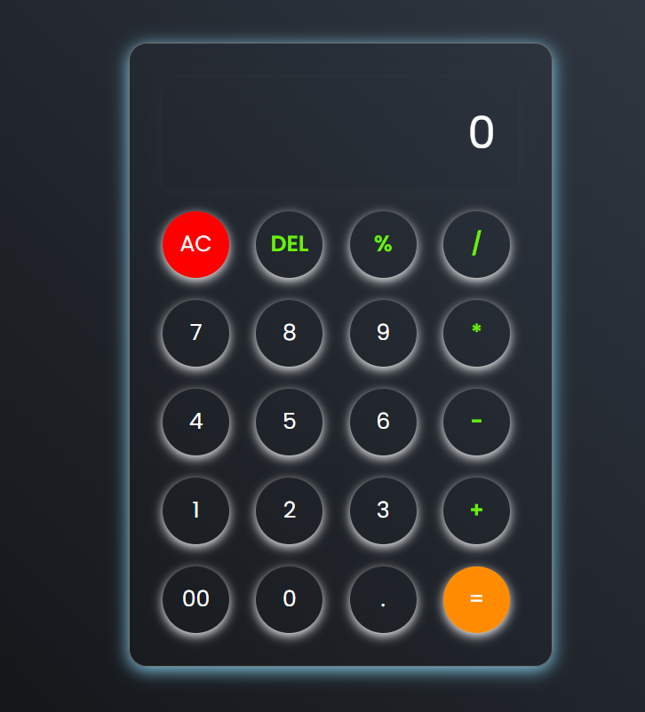

## 🧮 Calculator Web Application

A simple, responsive, and user-friendly Calculator Web Application built using HTML5, CSS3, and Vanilla JavaScript.

This project was developed as part of the OASIS INFOBYTE Web Development Internship – Level 2.

---

## 📌 Project Overview

The Calculator Web Application allows users to perform basic mathematical operations through an interactive and responsive interface.

It provides a clean design, easy-to-use buttons, and real-time input handling.

## ✨ Features

- ➕ Addition
- ➖ Subtraction
- ✖️ Multiplication
- ➗ Division
- 🔢 Decimal number support
- 🧹 AC (All Clear) functionality
- ⌫ DEL (Delete) functionality
- ⚠️ Division-by-zero error handling
- 📱 Responsive design
- 🎨 Interactive button hover effects

## Live Demo : https://bhargavsankhat007.github.io/OIBSIP/

## 🛠️ Technologies Used

Technology| Purpose
---------------------
HTML5     | Structure of the calculator
CSS3      | Styling and responsive layout
JavaScript| Calculator functionality and logic

## 📂 Project Structure

WebDev-L2-Calculator/
│
├── index.html
├── style.css
├── script.js
└── README.md

## 🚀 How to Run the Project

1. Clone this repository:
   
   git clone https://github.com/BhargavSankhat007/OIBSIP.git

2. Open the project folder.

3. Open "index.html" in your web browser.

4. Start using the calculator.

## 📸 Screenshots

## 🎓Internship Details

- Organization: OASIS INFOBYTE
- Internship Track: Web Development
- Level: Level 2
- Project: Calculator

👨‍💻 Author
Bhargav Sankhat

BCA Graduate | Frontend Web Development Enthusiast
---
⭐ If you like this project, consider giving this repository a star!